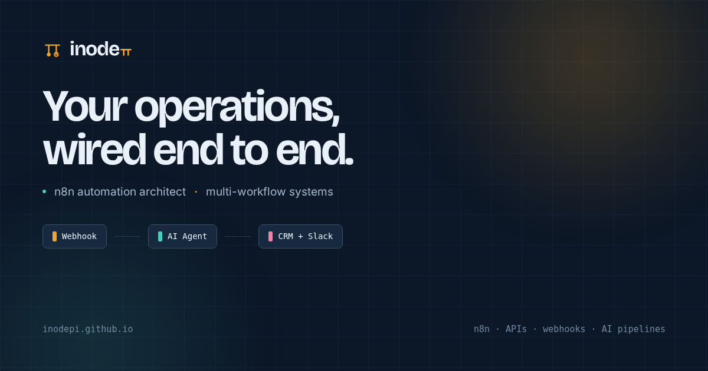

# inodepi

Portfolio and client-acquisition site for an n8n automation architect. Built with Astro,
Tailwind CSS, and GitHub Pages (static output).

Live site: https://inodepi.github.io



## Local development

```bash
npm install
npm run dev
```

Build and preview the production output:

```bash
npm run build
npm run preview
```

Run the tests:

```bash
npm test
```

## Deploy

1. **Pages URL** — `site` is set to `https://inodepi.github.io` and the site is served
   from the domain root (no `base` path).
2. **Pages source** — repository Settings → Pages → Source: **GitHub Actions**.
3. The workflow in `.github/workflows/deploy.yml` builds and deploys on every push to `main`.
4. Verify a deploy with `gh run list --limit 1` / `gh run watch <id>`.

## Featured builds

The homepage grid (`src/data/projects.ts` → `automationRepos`) lists the live builds:

| Build | URL | What it does |
|---|---|---|
| **Lead Intake** | `/lead-intake/` | A five-field intake form (name, email, contact window, what to automate, consent). One submit writes a row to the `Intake` tab, posts a Discord embed to `#new-leads`, and emails the lead a confirmation. Contact windows are generated in the visitor's timezone. Live on this site. |
| **AI Lead Enrichment** | `/lead-enrichment/` | Three n8n workflows enrich each lead from its own site, send 15 researched emails a day at 09:30 in the prospect's timezone, and follow up three times until someone replies. |
| **Dead Lead Retrieval** | `/dead-lead-retrieval/` | A daily run reopens dormant leads with context-aware check-ins it sends itself, flips the row to `Sent`, pings Discord (`#dead-leads`), and marks `Replied` when they answer. |
| **AR Invoice Reminder** | `/ar-invoice-reminder/` | A daily run computes days overdue, sends a tone-matched reminder (friendly / firm / urgent) from your inbox, logs the follow-up, and pings `#invoices`. A reply claiming payment flips the row to `Paid (claimed)` and stops the sequence. |
| **Omnichannel AI Receptionist** | `/omnichannel-receptionist/` | One n8n receptionist answers voice, SMS and chat, books real calendar slots and logs every thread. Linked from the Lead Intake card as an add-on at a different price. |

The cold-outreach pipeline (CSV ingest → enrichment → sending → reply watcher) lives in
`../cold-outreach-pipeline/` and runs on the `LEADS` spreadsheet.

## Live n8n workflows

| Workflow | ID | Role |
|---|---|---|
| Intake Submit | `VKfmNsTcDJGKlCx7` | Intake form → sheet + Discord + confirmation email |
| Dead Lead Retrieval | `QGD295ZxiiE8NKV0` | Daily check-ins + reply detection |
| AR Invoice Reminder | `zH53iW768EaqUPMv` | Daily invoice reminders + payment-claim detection |
| Cold Outreach 1 | `QnWUBFlLDs4SsuKr` | CSV ingest + enrichment |
| Cold Outreach 2 | `JnXjpQMrv09mP5OT` | Cold email sender (15/day) |
| Cold Outreach 3 | `hWW9X2LDmZ5bO3tC` | Reply watcher + follow-ups |

## Contact and intake

The site carries a floating intake form (bottom-right on every page) that posts to the
`Intake Submit` n8n workflow, plus a custom two-week calendar that sends visitors to the
Cal.com discovery event with `?date=YYYY-MM-DD`. `siteConfig.calendarUrl` sets the
destination.

## Editing content

Everything editable lives in two places.

### `src/data/projects.ts`

- `siteConfig` — name, email, Cal.com link, social URLs, response time.
- `automationRepos` — the featured repository cards. Toggle `featured` to choose what shows.
  `note` / `noteLink` add a small pricing or scope line under the summary.
- `sideProjects` — the side project cards. Set `size: 'large'` on one entry to make it the
  feature card above the grid; `demoUrl` makes the card link to a playable build.

### `src/components/IntakeFab.astro`

The floating intake form mounted on every page via `Base.astro`. It generates two contact
windows per day (10:30 PM and 2:30 AM, Asia/Manila) and renders them in the visitor's
timezone, then posts to `/webhook/intake-submit`.

### `src/styles/global.css`

The `:root` block holds the dark palette; the `@media (prefers-color-scheme: light)`
block holds the light palette. The site follows the visitor's browser setting. The header
carries an Auto / Light / Dark theme button; the choice is saved in `localStorage`.

## SEO

- `@astrojs/sitemap` generates `/sitemap-index.xml` and `/sitemap-0.xml` at build time.
- `public/robots.txt` points crawlers at the sitemap.
- Every page has a canonical URL, OG/Twitter meta, a 1200×630 social card (`public/og.png`)
  and JSON-LD (`ProfessionalService` on home, `CreativeWork` + breadcrumbs on the build pages).
- After deploying, submit `https://inodepi.github.io/sitemap-index.xml` in Google Search
  Console (URL-prefix property; verify with the HTML file or meta tag Google provides).

## Brand

- **Mark:** a π drawn as a node graph — two legs ending in nodes, one filled, one outlined.
- **Wordmark:** `inode` + the π glyph, read as “I · node · Pi”. The favicon and mark
  live in `public/favicon.svg` and `public/logo.svg`.

## Structure

```
src/
  components/   Hero, SpeedToLead, VideoBeats, Capabilities,
                FeaturedRepos, AgentSkills, SideProjects, Process,
                Contact, ProjectShell, IntakeFab, Footer, BrandMark, PiGlyph
  data/         projects.ts (typed content)
  layouts/      Base.astro, DemoLayout.astro
  lib/          changelog.ts (markdown renderer)
  pages/        index, extras, project pages, demo pages
  styles/       global.css (design tokens)
public/         favicon.svg, videos/, images/
tests/          node:test smoke tests
```
