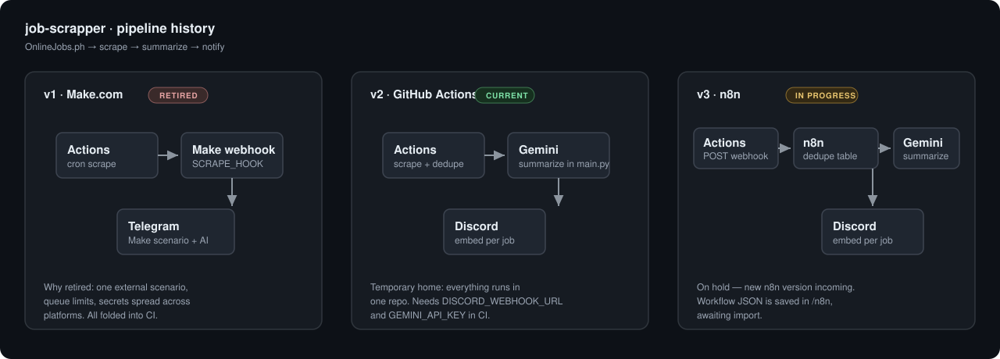
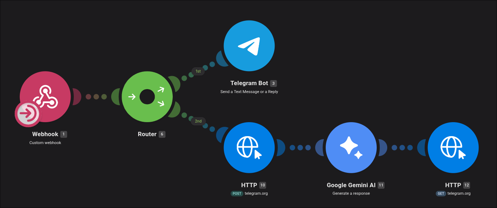
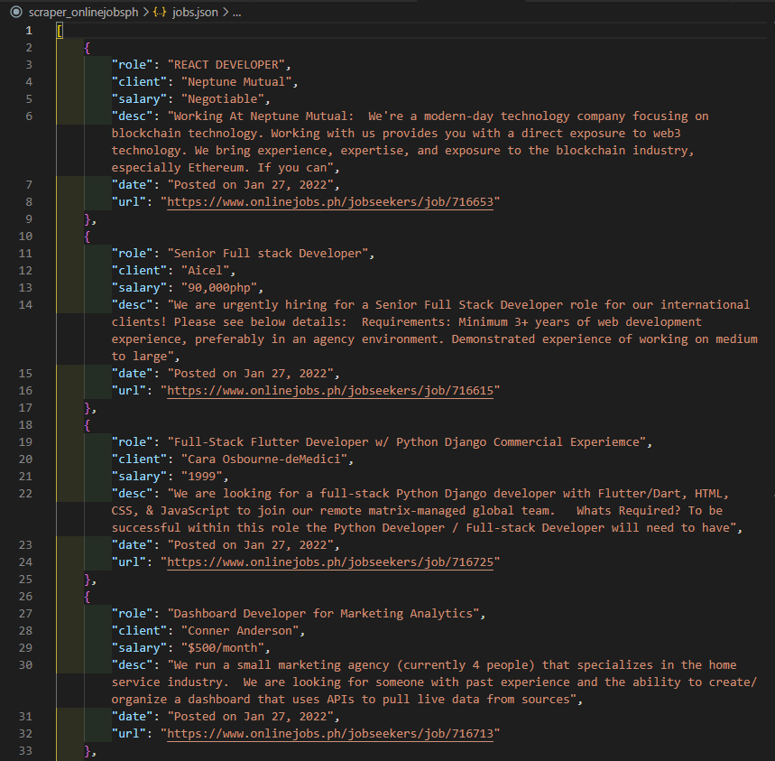
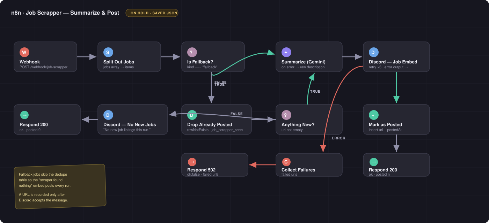

# job-scrapper

Scrapes [OnlineJobs.ph](https://www.onlinejobs.ph) for the newest remote job postings in
configurable categories, summarizes each one with AI, and posts a Discord embed per job.



## Overview

`main.py` searches OnlineJobs.ph for each configured keyword, keeps the freshest listing
per keyword, pulls the full description and the employer's "How to apply" section, then
summarizes and delivers. It runs from GitHub Actions on a 4-hour cron and is polite by
design: public pages only, browser-like headers, randomized 5–12s pauses between searches,
and backoff when the site serves a bot-check page.

The pipeline has moved through three stages. The summary below is the short version; each
stage has its own section.

| Stage | Runs the scrape | Summarizes | Delivers | State |
| --- | --- | --- | --- | --- |
| v1 · Make.com | GitHub Actions | Make scenario | Telegram | **Retired** |
| v2 · GitHub Actions | GitHub Actions | Gemini in `main.py` | Discord webhook in `main.py` | **Current (temporary)** |
| v3 · n8n | GitHub Actions | Gemini in n8n | Discord node in n8n | **On hold** |

## Old — Make.com (Retired)

GitHub Actions scraped the listings and POSTed each job as JSON to a Make.com webhook
(the `SCRAPE_HOOK` repository secret). A Make scenario then routed the payload: webhook →
router → Telegram bot for delivery, with Gemini in the same scenario for the summary.



The original payload sent to the Make webhook looked like this:

```json
[
  {
    "role": "REACT DEVELOPER",
    "client": "Neptune Mutual",
    "salary": "Negotiable",
    "desc": "Working At Neptune Mutual: ...",
    "date": "Posted on Jan 27, 2022",
    "url": "https://www.onlinejobs.ph/jobseekers/job/716653"
  }
]
```



**Why retired:** the scrape lived in one place and the delivery logic in another. Every
change meant touching both, jobs sat behind a Make queue (the scraper was tuned to send at
most one job per keyword to keep it light), and secrets were split across GitHub and Make.
Moving summarization and delivery into the same GitHub Actions run removed the external
scenario entirely; `SCRAPE_HOOK` is now unused.

## Current — GitHub Actions

Everything runs in one workflow: scrape → dedupe → Gemini summary → Discord embed.

### How it works

1. For each **category**, searches OnlineJobs.ph for each of its keywords (random 5–12s
   pause between searches).
2. Parses every result card and sorts by the exact posting timestamp.
3. Keeps the top listing per keyword, dedupes across keywords, caps at `MAX_PER_CATEGORY`
   per category.
4. Visits each picked listing and pulls the **full description**, splitting out the
   employer's "How to Apply" section when present.
5. Summarizes each job with Gemini and posts **one Discord embed per job**.
6. Dedupes by URL via `seen_jobs.json` so repeat runs don't spam the channel.

### Categories

`CATEGORIES` uses **pipe** to separate categories and **semicolon** for keywords inside a
category. The first keyword names the category.

```
automation;n8n;make.com;zapier|python|customer support;email support;chat support|virtual assistant
```

### Discord embed

Each job is sent as its own embed with a title linking to the listing, the AI summary,
and fields for Category, Rate, Type, Posted, and How to apply.

### Local usage

```bash
export DISCORD_WEBHOOK_URL="https://discord.com/api/webhooks/..."
export GEMINI_API_KEY="your-gemini-key"

python main.py                    # default categories, 1 per category
DRY_RUN=1 python main.py          # preview payloads, send nothing
make dry                          # same as above
make s                            # full run

CATEGORIES="python coder|customer support;chat support" MAX_PER_CATEGORY=2 python main.py
```

Requires Python 3.8+ and `requests`.

### GitHub Actions

Workflow: [`.github/workflows/scrape.yml`](.github/workflows/scrape.yml) — cron
`0 */4 * * *` (UTC) plus manual dispatch.

Secrets: `DISCORD_WEBHOOK_URL`, `GEMINI_API_KEY`.
Variables (optional): `GEMINI_MODEL` (default `gemini-1.5-flash`), `CATEGORIES`,
`MAX_PER_CATEGORY`.

`seen_jobs.json` is committed back to the repo after each run to prevent duplicate posts.

> **Current status:** the two secrets are not set on the repository, so recent scheduled
> runs fail at the `DISCORD_WEBHOOK_URL` check before scraping. Set them to make CI green.

## n8n Migration (On Hold — new n8n version incoming)

The plan: GitHub Actions keeps the cron and the polite scraping, then POSTs one batch of
jobs to an n8n webhook. n8n owns dedupe state, the Gemini summary, and the Discord post.

**Status: on hold until the new n8n version is in place.** The workflow is written and
saved, not deployed.

What is already in the repo:

- [`n8n/job-scrapper-n8n-workflow.json`](n8n/job-scrapper-n8n-workflow.json) — import-ready
  workflow: Webhook (header auth) → Split Out → fallback bypass → `job_scrapper_seen`
  dedupe → Gemini summary → Discord embed → mark as posted. Returns `200` on success and
  `502` with the failed URLs when a post cannot be delivered.



What happens at cutover:

1. Import the JSON into n8n and attach the Discord Webhook and Google Gemini credentials.
2. Create the data table `job_scrapper_seen` with columns `url` (string) and `postedAt` (string).
3. Generate a header-auth token and set `N8N_WEBHOOK_URL` + `N8N_WEBHOOK_TOKEN` as GitHub secrets.
4. Point the workflow's run step at the webhook and drop the `seen_jobs.json` commit-back.

## Plans

- Set `DISCORD_WEBHOOK_URL` and `GEMINI_API_KEY` so the current pipeline runs green again.
- Resume the n8n migration when the new n8n version lands: import the saved workflow,
  create the dedupe table, and switch GitHub Actions to the webhook.
- After n8n takes over delivery, consider fan-out to other channels (Telegram, Slack)
  from the same workflow.

## Fair-use & TOS notes

- **Public pages only** — search results and listings a logged-out visitor sees.
- **Human-like pacing** — randomized 5–12s between searches, 2–5s before detail pages,
  exponential backoff on bot-check pages.
- **Tiny volume** — one run every 4 hours, a handful of requests per run.
- Respects anti-bot interstitials instead of evading them.

## Design docs

- Design: [`docs/superpowers/specs/2026-11-11-job-scrapper-n8n-design.md`](docs/superpowers/specs/2026-11-11-job-scrapper-n8n-design.md)
- Plan: [`docs/superpowers/plans/2026-11-11-job-scrapper-n8n.md`](docs/superpowers/plans/2026-11-11-job-scrapper-n8n.md)
